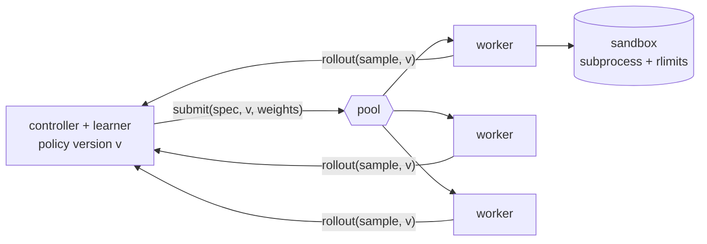

# rollout-fabric

[](https://github.com/eljandoubi/rollout-fabric/actions/workflows/ci.yml)

Asynchronous rollout generation for RL post-training of code models, at toy scale.

In RL post-training (GRPO, PPO, ...) most of the wall time goes to *generating* completions, and
generation times have a heavy tail: one long completion makes a whole synchronous batch wait.
`rollout-fabric` is a small, tested implementation of the standard fix and of the parts around it:

- a learner that **never waits for the slowest worker** and trains on whatever is fresh enough;
- a **staleness bound**: every sample carries the version of the policy that produced it, and is
  dropped, never trained on, once it is more than `max_staleness` learner steps old;
- **crash recovery**: a killed worker is restarted and only the rollout it was running is asked again;
- a **sandbox** that scores generated programs (rlimits, clean environment, process-group kill);
- two interchangeable backends, **threads** and **Ray actors**, behind a 4-method interface;
- metrics as JSONL, DogStatsD gauges and a Prometheus text file.

The "model" is a softmax policy over a menu of candidate programs for six small coding tasks, trained
with REINFORCE and a clipped importance ratio. Latencies are simulated (log-normal). That is on
purpose: the whole system runs on a laptop, and what is under test is the control loop, not the model.

## Result

Same work for both modes: 40 learner steps of 16 rollouts, 8 workers, mean generation time 50 ms,
a 30 ms learner step, `max_staleness = 2`. Median of 3 seeds on an Apple M4 (10 cores) with other
processes running. The sandbox is off here so that the numbers measure scheduling and not process
start-up (see below for it on).

| latency spread (log-normal σ) | sync, samples/s | async, samples/s | speed-up | seconds to reward 0.9 | dropped as stale (640 consumed) |
|:--|--:|--:|--:|--:|--:|
| 0.5 | 80.4 | 138.9 | 1.7x | 5.3 → 4.4 | 0 |
| 1.0 | 58.8 | 139.0 | 2.4x | 7.3 → 3.3 | 10 |
| 1.5 | 42.2 | 145.4 | 3.5x | 11.1 → 3.6 | 21 |

- The heavier the tail, the more async gains: sync pays for the slowest rollout of every batch,
  async pays for the average.
- It learns as well: the final reward is 0.90 to 0.91 in both modes.
- The price is lag. At σ = 1.0 consumed samples are 0.85 learner steps old on average (p95: 2),
  and 10 samples (1.6 percent of the 640 consumed) were dropped because they came back too late.
- On Ray actors (σ = 1.0): 57.3 → 124.4 samples/s (2.2x), reward 0.9 after 7.6 → 4.6 s.
- With the real sandbox on (4 workers, threads) the gain is 21.0 → 27.8 samples/s (1.3x): every
  rollout then starts a Python process, so the laptop's CPU is the limit and not the schedule.
- Crashes (Ray, 5 percent of rollouts kill their worker process): 36 crashes, all 640 samples
  still consumed, 12.5 s against 5.1 s without crashes, because each restart costs a second or two.

These show scheduling behaviour under simulated latencies. They say nothing about the speed of a
real LLM trainer. Reproduce with `make bench` (or `rollout-fabric compare --help`).

## How it works



**Sync** (`run_sync`): every step submits a batch and waits for all of it.

**Async** (`run_async`): the workers are always busy.

1. A rollout is stamped with the policy version `v` it was generated with.
2. When the learner is about to train at version `v'`, a sample with `v' - v > max_staleness` is
   dropped and counted. The rest are used oldest first, 16 at a time. So **no consumed sample is
   ever more than `max_staleness` steps old**; a test checks it with random latencies for
   `max_staleness` in 0, 1, 2 and 4, and another checks that a scripted straggler is dropped.
3. Dispatch stops when `dispatched - consumed - dropped` reaches `(max_staleness + 1)` batches, so
   the controller cannot run further ahead of the learner than the bound allows. At most
   `workers * inflight_per_worker` rollouts are queued at the pool.
4. A sample from an older policy is corrected with the ratio `pi_now / pi_behavior`, clipped at 2.0,
   with the batch mean reward as baseline.

**Reproducibility.** A rollout's randomness depends on `(seed, sample id, attempt)` only, never on
which worker ran it. In sync mode threads and Ray give the same learning curve (there is a test).

**Fault tolerance.** The Ray pool hands work to an actor only when it is idle, so one slow rollout
never blocks work queued behind it and a dead worker loses at most the one rollout it was running.
An injected crash is a real one: the actor kills its own process with SIGKILL, Ray restarts it
(`max_restarts=-1`), the pool raises `WorkerCrashed`, and the controller asks again with
`attempt + 1`, which gives new draws. A sample that kills its worker `max_attempts` times in a row
stops the run with its id in the message instead of looping.

**Sandbox.** Each candidate runs in its own session with `python -I -S`, an empty environment and
working directory, and limits on CPU time, file size, open files and core dumps (address space on
Linux). The expected answers never leave the parent, and the child's verdict is the last marked line
it prints, so printing a fake one earns nothing. A timeout kills the whole process group.
**This is a guard rail, not a security boundary**: the child shares the kernel, the network and the
user's files. For untrusted code, put the same interface in front of a container, gVisor or
Firecracker.

## Run it

```sh
pip install -e ".[dev]"            # threads
pip install -e ".[ray,dev]"        # and Ray actors

rollout-fabric compare --repeat 3 --no-sandbox --workers 8      # sync against async, as above
rollout-fabric run --mode async --backend ray --crash-prob 0.05 \
    --jsonl steps.jsonl --prom-file rf.prom --statsd 127.0.0.1:8125

docker build -t rollout-fabric . && docker run --rm rollout-fabric compare --quick
docker build --build-arg EXTRAS=ray -t rollout-fabric:ray .     # with the Ray backend
```

Every field of `Config` is an option (`--workers`, `--batch-size`, `--steps`, `--max-staleness`,
`--mean-latency-s`, `--latency-sigma`, `--train-step-s`, `--lr`, `--seed`, `--crash-prob`,
`--max-attempts`, `--sandbox/--no-sandbox`, ...). As a library:

```python
from rollout_fabric.config import Config
from rollout_fabric.fabric import run_async
from rollout_fabric.pool import make_pool

cfg = Config(workers=8, max_staleness=2)
pool = make_pool("thread", cfg)  # or "ray"
try:
    stats = run_async(cfg, pool)
finally:
    pool.close()
print(stats.samples_per_s, stats.p95_staleness, stats.time_to_reward(0.9))
```

**Metrics.** `--jsonl` appends one JSON object per learner step. `--statsd HOST:PORT` sends the step
gauges (`rollout_fabric.reward`, `.mean_staleness`, `.dropped_stale`, `.crashes`, ...) tagged
`mode:<sync|async>` in the DogStatsD format over UDP; a dead endpoint never stops training.
`--prom-file` writes the final numbers in the Prometheus text format, for a textfile collector.

## Development

```sh
make check        # ruff format check, ruff, mypy --strict, tests with a 90 percent coverage gate
make test-ray     # the tests that need Ray (about a minute)
make mutate       # mutation check, see below
```

- Over 140 tests run on every push on Python 3.11 and 3.12; 19 more run against a local Ray. Line
  coverage is 100 percent for everything but the Ray module, which is measured by its own job.
- `scripts/mutate.py` changes one line at a time in a copy of the repository (29 mutants of the
  controller, worker, pool, policy and sandbox, plus 3 for Ray) and reports the ones the tests do not
  notice. All are killed. The first run left two alive and one hanging; each became a test or a fix
  (a pool that handed workers the learner's own array, a parser that took the first verdict marker
  instead of the last, a retry cap that relied on the counter it was protecting).
- CI: lint and types, the test matrix, the Ray tests, a sync-against-async smoke test with the
  sandbox on, a Docker build that runs as a non-root user, and the mutation check on pushes to main.

```
src/rollout_fabric/
  config.py     settings, one dataclass
  policy.py     softmax policy over candidate programs, REINFORCE with a clipped ratio
  tasks.py      six coding tasks, each with correct, wrong, raising, hanging and broken candidates
  sandbox.py    run one candidate with limits, judge the verdict in the parent
  worker.py     one rollout as a function of (seed, sample, attempt)
  pool.py       the pool interface, thread pool, backend factory
  ray_pool.py   Ray actors that pull work
  fabric.py     the sync and async controllers, run statistics
  metrics.py    JSONL, DogStatsD, Prometheus
  report.py     medians over runs, the markdown table
  cli.py        rollout-fabric run | compare
```

## What this is not

- Not a trainer for real models: the policy is a table of logits, generation and the learner step are
  `sleep`s, and nothing is sent over a network. A real system also has to broadcast weights, shard
  them, and cut a generation in half when the weights change; none of that is modelled here.
- Staleness is counted in learner steps, not tokens.
- Each Ray actor runs one rollout at a time; there is no continuous batching.
- `RLIMIT_AS` is not enforced on macOS, so the memory limit of the sandbox only applies on Linux.

## Related work

The bounded-staleness idea follows asynchronous RL systems for language models such as AReaL
(Fu et al., 2025), and the correction of old samples by importance weights actor-learner systems such
as IMPALA (Espeholt et al., 2018). This repository is an independent small-scale implementation, not a
reproduction of either.

## License

Apache-2.0, see [LICENSE](LICENSE).
